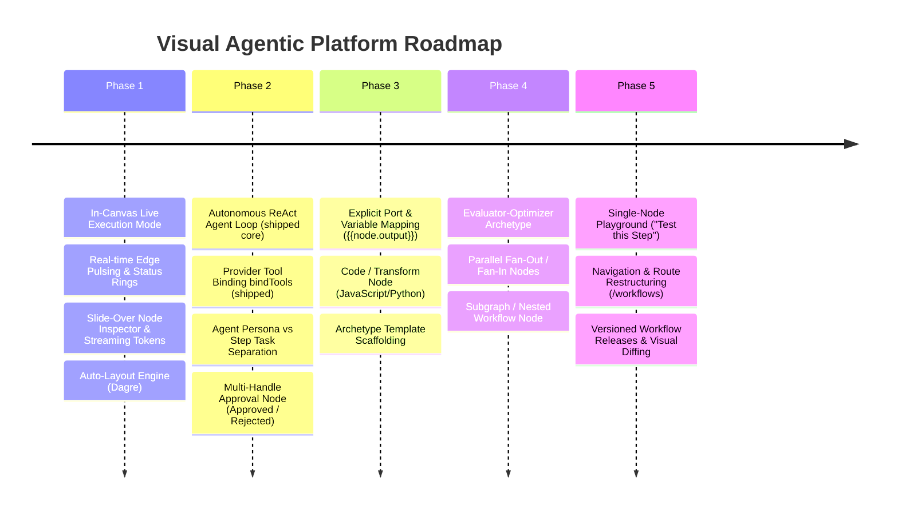

# Senior AI Engineer Audit & Architecture Recommendations
## Visual Agentic Platform & Workflow Builder

**Project:** Multi-Agent Platform / Studio  
**Date:** November 2026  
**Document Status:** Approved Architecture Plan  
**Target Audience:** Engineering Leads, AI Systems Engineers, Frontend Architects  

---

## 1. Executive Summary

This audit evaluates the repository against its primary mission: **to make it completely possible to create, test, execute, and observe agentic platforms and multi-agent workflows in an intuitive visual environment**.

### The Core Finding
The project has established an **enterprise-grade backend and security infrastructure**:
- Multi-tenancy backed by PostgreSQL Row Level Security (RLS) across 28 tables.
- A zero-trust [Credential Broker](file:///E:/hossein/ai_agent/multi-agent/src/broker/service.ts) delivering single-use, bounded leases without long-lived process environment leaks.
- Strict isolation via [`ContainerWorkerRuntime`](file:///E:/hossein/ai_agent/multi-agent/src/agents/runtime/workerRuntime.ts) (read-only rootfs, dropped capabilities, no network) for untrusted CLI agents (Codex, Claude-Code).
- Strong typing with versioned [Node Contracts](file:///E:/hossein/ai_agent/multi-agent/packages/types/src/nodeContract.ts), payload bounds, and durable PostgreSQL checkpointing for human approval resume.

**However, the visual environment currently behaves as a static pipeline diagrammer rather than an interactive, observable multi-agent studio.**

Key capabilities required by modern visual agentic platforms (LangGraph Studio, Dify, Langflow, Rivet, AutoGen Studio). Status against this audit:
1. **In-Canvas Live Execution (shipped)**: Studio Design|Live dual mode keeps operators on the React Flow canvas when running (`/org?workflowId=&runId=`). The dedicated `/runs/[runId]` page remains for bookmarks with an “Open on canvas” deep link.
2. **Autonomous Agent Loops (ReAct) — shipped** (feature `012-react-agent-loop`): API agents bind assigned tools via `bindTools`, run a bounded ToolRuntime-backed loop (`executionMode` / `maxToolSteps`), and emit nested `tool.*` events. Standalone tool nodes remain valid for linear flows.
3. **Implicit Data Passing (`state.lastValue`)**: There is no explicit variable mapping or visual port wiring. Data passes implicitly from step to step, causing data-loss friction when branching or joining.
4. **Registry Mutation Anti-Pattern**: Editing an agent node on the canvas mutates the global `AgentRecord` in the database, preventing multiple nodes from sharing an agent persona with different step instructions.
5. **Topology Restrictions**: The platform artificially restricts topologies to `linear-pipeline` and `hierarchical-supervisor`, blocking essential patterns like Evaluator-Optimizer feedback loops, parallel scatter-gather, and nested subgraphs.

---

## 2. Current Architecture vs. Visual Agentic Goals

```mermaid
flowchart TD
    subgraph Shipped Studio Live Path
        A[Visual Editor: apps/web] -->|Click Run| B[Stay on /org Live Mode]
        B --> C[React Flow status rings + traversed edges]
        B --> C2[Inspector + approval banner + run tray]
        A -->|Open on canvas| B
        R[/runs/runId bookmark] -->|Optional| B
    end

    subgraph Remaining Gaps
        A -->|Edit Agent Node| D[Mutates Global AgentRecord in DB]
        G[Data Flow] -->|Implicit| H[state.lastValue]
        H2[Data Flow] -.->|Still needed| I2[Typed Ports & mustache {{node.output}} Expressions]
    end

    subgraph Shipped ReAct Path
        E2[WorkflowCompiler] -->|resolvedTools + toolRuntime| F2[ApiAgentExecutor ReAct Loop]
        F2 -->|bindTools + ToolRuntime| G2[Nested tool.* events]
    end
```

---

## 3. In-Depth Technical Findings & Recommendations

### Finding 1: In-Canvas Live Execution & Observability — **SHIPPED** (feature `011-canvas-live-observability`)
* **Location:** [`EditorToolbar.tsx`](file:///E:/hossein/ai_agent/multi-agent/apps/web/src/components/workflow/EditorToolbar.tsx), [`WorkflowEditor.tsx`](file:///E:/hossein/ai_agent/multi-agent/apps/web/src/components/workflow/WorkflowEditor.tsx), [`FlowCanvas.tsx`](file:///E:/hossein/ai_agent/multi-agent/apps/web/src/components/workflow/FlowCanvas.tsx), `apps/web/src/components/workflow/live/*`
* **Current behavior (implemented):**
  - **Design | Live dual mode** on `/o/{org}/org?workflowId=&runId=`. Clicking **Run** calls `runService.startRun` and `enterLive(runId)` — operators stay on React Flow (no primary redirect to `/runs/[runId]`).
  - Live chrome: status rings / skipped dimming, traversed edge animation, Node Execution Inspector, approval banner + gate modal, collapsible run tray (cancel/retry/filters), Exit Live → Design.
  - Topology for Live prefers the run execution snapshot (`getRunDefinition` / sessionStorage); the editable draft is not silently shown as the observed graph.
  - Standalone [`/runs/[runId]`](file:///E:/hossein/ai_agent/multi-agent/apps/web/src/app/(authenticated)/o/[orgSlug]/runs/[runId]/page.tsx) remains for bookmarks and exposes **Open on canvas**.
* **Remaining polish / follow-ups (non-blocking):**
  - Continuous-stream FPS / SC-005 field measurement under production-like token volume.
  - Further HITL clarification edge cases as product policy evolves.
* **Historical note:** Earlier builds redirected Run to a non–React Flow `RuntimeGraph` grid; that path is no longer the studio primary UX.

---

### Finding 2: Autonomous Agent Loop (ReAct) — **SHIPPED** (feature `012-react-agent-loop`)
* **Location:** [`src/agents/runtime/apiAgentExecutor.ts`](file:///E:/hossein/ai_agent/multi-agent/src/agents/runtime/apiAgentExecutor.ts), [`src/agents/runtime/toolBinding.ts`](file:///E:/hossein/ai_agent/multi-agent/src/agents/runtime/toolBinding.ts), [`apps/server/src/compiler/workflowCompiler.ts`](file:///E:/hossein/ai_agent/multi-agent/apps/server/src/compiler/workflowCompiler.ts), [`NodeForms.tsx`](file:///E:/hossein/ai_agent/multi-agent/apps/web/src/components/workflow/properties/NodeForms.tsx)
* **Current behavior (implemented):**
  - API agents in `executionMode: "react"` (default when tools are assigned) call `bindTools`, run a bounded reason–act–observe loop, and execute only assigned tools through `ToolRuntime`.
  - `maxToolSteps` clamped to 1–10 (default 5); ceiling fails closed with `AGENT_TOOL_LIMIT_EXCEEDED`.
  - Nested `tool.started` / `tool.completed` / `tool.failed` events carry the parent agent `nodeId` for the live inspector.
  - Operator controls: Single-turn vs ReAct and max tool steps on agent / agent-node properties.
  - Primary suite: `tests/apiAgentExecutorReAct.test.ts`.
* **Remaining polish / follow-ups (non-blocking):**
  - CLI/worker agent adapters remain single-turn (explicitly out of scope for 012).
  - Mutating tools that still `requiresApproval: true` need an approval path before autonomous use (policy fail-closed today).
* **Historical note:** Earlier builds performed a single `model.invoke` with no `bindTools`; tools only ran as separate canvas nodes.

---

### Finding 3: Implicit Data Passing (`state.lastValue`) vs. Explicit Port/Variable Mapping
* **Location:** [`apps/server/src/compiler/workflowCompiler.ts`](file:///E:/hossein/ai_agent/multi-agent/apps/server/src/compiler/workflowCompiler.ts#L879-L895) (`valueForNode`)
* **Problem:**
  ```ts
  function valueForNode(node: WorkflowNode, state: RuntimeState, definition: WorkflowDefinition): unknown {
    if (node.type === "condition" || node.type === "input") return state.lastValue;
    const incomingEdges = definition.edges.filter((edge) => edge.target === node.id);
    if (node.type === "output" && (node.config as { inputMode?: string }).inputMode === "last_value") return state.lastValue;
    const incoming = incomingEdges.map((edge) => edge.source);
    if (incoming.length < 2) return state.lastValue;
    const results = state.nodeResults ?? {};
    const branches = Object.fromEntries(
      incoming.filter((source) => Object.prototype.hasOwnProperty.call(results, source)).map((source) => [source, results[source]]),
    );
    return Object.keys(branches).length > 1 ? { branches } : state.lastValue;
  }
  ```
* **Why it matters:**
  When complex workflows diverge and rejoin, downstream nodes have no reliable way to select which upstream node's output they receive without writing custom code or manually passing keys through `memory` nodes.
* **Recommendations:**
  1. **Template Expression Engine**:
     - Allow field referencing in node configurations and prompts:
       - `{{input.customerQuery}}`
       - `{{nodes.triage_agent.output.category}}`
       - `{{nodes.db_fetch.output.records[0].id}}`
  2. **Visual Variable Picker**:
     - In the node properties panel, provide an autocomplete or pill-picker showing available upstream outputs in the graph.
  3. **Visual Handle Mapping (Multi-Port Nodes)**:
     - Allow nodes to expose specific output ports (e.g., `text`, `json`, `error`) and input ports (e.g., `prompt`, `context`, `tools`).

---

### Finding 4: Shared Registry Mutation vs. Step-Specific Configuration
* **Location:** [`apps/web/src/components/workflow/properties/NodeForms.tsx`](file:///E:/hossein/ai_agent/multi-agent/apps/web/src/components/workflow/properties/NodeForms.tsx#L38-L72)
* **Problem:**
  When a user edits an Agent node in [`NodeForms.tsx`](file:///E:/hossein/ai_agent/multi-agent/apps/web/src/components/workflow/properties/NodeForms.tsx), changing the form values calls:
  ```ts
  const patchAgent = (patch: Partial<AgentRecord>) => {
    if (!agent) return;
    updateAgentRecord(agent.id, patch);
  };
  ```
  This immediately mutates the **shared global entity** in the registry.
* **Why it matters:**
  If a workflow uses the same "Developer Agent" in two places (e.g. Node A: "Generate code from spec"; Node B: "Patch bugs found during QA"), modifying Node A's prompt or temperature corrupts Node B and any other workflow referencing that agent.
* **Recommendations:**
  1. **Clean Separation of Concerns**:
     - **Agent Entity (Registry)**: Defines the persona, model provider, default credentials/tool access, and base system instructions.
     - **Agent Node Config (Workflow-Specific)**:
       ```ts
       export interface AgentNodeConfig {
         agentId: string;
         /** Node-specific task instruction (e.g., "Refactor the code provided in {{input}}") */
         taskInstruction?: string;
         /** Overrides for temperature, reasoning effort, or max tokens */
         modelSettingsOverride?: Partial<AgentModelSettings>;
         /** Step-specific tool restrictions (subset of agent's allowed tools) */
         activeTools?: string[];
         mutatesCode?: boolean;
       }
       ```
  2. **Update the Properties Panel**:
     - Provide a "Base Agent" dropdown selector.
     - Provide a "Step Instructions" textarea with variable substitution hints.
     - Only allow editing the base agent if explicitly clicking "Edit Agent in Registry".

---

### Finding 5: Topology Constraints & Missing Multi-Agent Archetypes
* **Location:** [`packages/types/src/archetype.ts`](file:///E:/hossein/ai_agent/multi-agent/packages/types/src/archetype.ts#L11), [`apps/server/src/compiler/validation.ts`](file:///E:/hossein/ai_agent/multi-agent/apps/server/src/compiler/validation.ts#L216-L255)
* **Problem:**
  The system strictly enforces only two archetypes: `"linear-pipeline"` and `"hierarchical-supervisor"`. Any cycle in a linear pipeline is rejected outright (`LINEAR_PIPELINE_CYCLE_FORBIDDEN`), while hierarchical supervisors mandate rigid hub-and-spoke routing with manual recursion guards.
* **Why it matters:**
  Standard multi-agent design patterns (Anthropic's "Building Effective Agents" taxonomy) cannot be expressed cleanly:
  1. **Evaluator-Optimizer**: A generator agent produces work, an evaluator critiques it against a rubric, and a feedback loop routes back to the generator until quality passes or iterations reach limit.
  2. **Parallel Fan-Out / Aggregator (Scatter-Gather)**: Spreading an input across 3 independent specialists (e.g. Security, Performance, UI Reviewers) and aggregating their structured feedback.
  3. **Sub-Workflows (Nested Graphs)**: Packaging a complex 5-node sub-routine as a single reusable block.
* **Recommendations:**
  1. **Expand Supported Archetypes**:
     - Add `"evaluator-optimizer"` with a first-class feedback loop and iteration ceiling.
     - Add `"autonomous-swarm"` for peer-to-peer delegation.
  2. **Add a Subgraph Node**:
     - A node that references another `WorkflowDefinition` by ID, mapping parent inputs to subgraph inputs and subgraph outputs back to the parent state.
  3. **Add Parallel Fan-Out / Fan-In Primitives**:
     - `parallel_split` and `parallel_join` nodes to trigger concurrent LangGraph branches safely with existing semaphore limits (`maxConcurrentBranches: 8`).

---

### Finding 6: Canvas Usability & Edge Routing Friction
* **Location:** [`apps/web/src/components/workflow/nodes/WorkflowNodes.tsx`](file:///E:/hossein/ai_agent/multi-agent/apps/web/src/components/workflow/nodes/WorkflowNodes.tsx#L158-L177), [`apps/web/src/components/workflow/properties/panels.tsx`](file:///E:/hossein/ai_agent/multi-agent/apps/web/src/components/workflow/properties/panels.tsx#L165-L200)
* **Problem:**
  - `ApprovalNodeComponent` has only a single bottom handle (`id="out"`).
  - To branch based on human decision, the user must draw an edge, click the edge to select it, open the right-side properties panel, change `edge.kind` from `normal` to `conditional`, and select `"approved"` or `"rejected"`.
  - Condition node handles use calculated left-percentages that often overlap or cause edge collision.
  - There is no automatic graph layout feature.
* **Recommendations:**
  1. **Explicit Color-Coded Handles on Approval Nodes**:
     - Green handle on bottom-left: `id="approved"` (auto-sets edge kind to `conditional` with branchKey `approved`).
     - Red handle on bottom-right: `id="rejected"` (auto-sets edge kind to `conditional` with branchKey `rejected`).
     - Amber handle in center: `id="needs_clarification"`.
  2. **Auto-Layout with Dagre**:
     - Integrate `@dagrejs/dagre` into [`EditorToolbar.tsx`](file:///E:/hossein/ai_agent/multi-agent/apps/web/src/components/workflow/EditorToolbar.tsx) with an "Auto-Arrange" button to organize nodes hierarchically with one click.
  3. **Interactive Archetype Scaffolding**:
     - In [`CreateWorkflowDialog.tsx`](file:///E:/hossein/ai_agent/multi-agent/apps/web/src/components/workflow/CreateWorkflowDialog.tsx), when selecting "Hierarchical Supervisor", pre-scaffold the canvas with:
       `[Input] -> [Supervisor Hub] -> [Condition Router] -> [Worker Agents] -> [Approval Gate] -> [Output]`,
       avoiding the immediate `MISSING_SUPERVISOR_HUB` validation error on empty graphs.

---

### Finding 7: Missing Visual Node Primitives
* **Problem:**
  Only 7 primitives exist: `agent`, `tool`, `approval`, `memory`, `condition`, `input`, `output`.
* **Recommendations:**
  Add four essential node primitives to the [`NodePalette.tsx`](file:///E:/hossein/ai_agent/multi-agent/apps/web/src/components/workflow/NodePalette.tsx):
  1. **`Code / Transform` Node**:
     - Runs a sandboxed JavaScript function (e.g. `(input) => ({ code: input.rawText.match(/```ts([\s\S]*?)```/)[1] })`) to reshape payloads between agents without wasting LLM tokens.
  2. **`Prompt / LLM` Node**:
     - Direct prompt template execution for deterministic translation/formatting without requiring an agent entity.
  3. **`Vector Retrieval (RAG)` Node**:
     - Visually queries the existing semantic long-term memory system using tenant-scoped collections.
  4. **`Sub-Workflow` Node**:
     - Reusable, nested workflows.

---

### Finding 8: Navigation & Information Architecture
* **Location:** [`apps/web/src/components/layout/AppSidebar.tsx`](file:///E:/hossein/ai_agent/multi-agent/apps/web/src/components/layout/AppSidebar.tsx#L50-L54)
* **Problem:**
  In `AppSidebar.tsx`, the primary workflow editor is labeled **"Org"** with href `/org` under "Orchestration", while organization goals are at `/organization` ("Goals"), and org settings are at `/settings`.
* **Why it matters:**
  New users looking for the visual workflow builder cannot discover it under the label "Org".
* **Recommendations:**
  - Rename the route and sidebar item to **Workflows** (`/workflows` or `/studio/workflows`).
  - Add a dedicated **Templates** section in the navigation or dashboard.

---

## 4. Prioritized Engineering Roadmap



### Phase 1: In-Canvas Live Execution & Observability (Quick Win, High Impact)
1. In [`FlowCanvas.tsx`](file:///E:/hossein/ai_agent/multi-agent/apps/web/src/components/workflow/FlowCanvas.tsx), accept an optional `runId` or subscribe to `useRunStore`.
2. Map `run.events` to:
   - Node status borders (pulsing cyan for running, green for completed, amber for paused).
   - Edge animation (`animated: true` on traversed edge IDs).
3. In [`EditorToolbar.tsx`](file:///E:/hossein/ai_agent/multi-agent/apps/web/src/components/workflow/EditorToolbar.tsx), update "Run" to toggle canvas into "Live Mode" with a bottom timeline drawer rather than navigating away.
4. Add an "Auto-Layout" button in [`EditorToolbar.tsx`](file:///E:/hossein/ai_agent/multi-agent/apps/web/src/components/workflow/EditorToolbar.tsx) using `@dagrejs/dagre`.

### Phase 2: Autonomous ReAct Engine & Step Configuration
1. ~~In `apiAgentExecutor.ts`, add tool calling via provider tools API / `bindTools`.~~ **Done** (`012-react-agent-loop`).
2. ~~Bounded loop with `maxToolSteps` via `ToolRuntime.execute()`.~~ **Done**.
3. In [`packages/types/src/index.ts`](file:///E:/hossein/ai_agent/multi-agent/packages/types/src/index.ts), expand `AgentNodeConfig` with `taskInstruction`, `temperatureOverride`, and `activeTools` (persona vs step separation — still open).
4. Update [`NodeForms.tsx`](file:///E:/hossein/ai_agent/multi-agent/apps/web/src/components/workflow/properties/NodeForms.tsx) so editing an agent node config does not mutate the shared `AgentRecord` (partially addressed by node-level `executionMode` / `maxToolSteps` overrides; full persona decoupling still open).
5. Update [`WorkflowNodes.tsx`](file:///E:/hossein/ai_agent/multi-agent/apps/web/src/components/workflow/nodes/WorkflowNodes.tsx) to give `ApprovalNodeComponent` distinct `approved` and `rejected` handles.

### Phase 3: Explicit Variable Mapping & Transform Nodes
1. Implement template interpolation in [`workflowCompiler.ts`](file:///E:/hossein/ai_agent/multi-agent/apps/server/src/compiler/workflowCompiler.ts) (e.g. resolve `{{nodes.<id>.output.<field>}}` against `state.nodeResults`).
2. Add a `transform` node type allowing lightweight JavaScript transformations between agent outputs.
3. Add starter archetype templates in [`CreateWorkflowDialog.tsx`](file:///E:/hossein/ai_agent/multi-agent/apps/web/src/components/workflow/CreateWorkflowDialog.tsx).

### Phase 4: Topology Expansion & Subgraphs
1. Introduce the `evaluator-optimizer` archetype in [`archetype.ts`](file:///E:/hossein/ai_agent/multi-agent/packages/types/src/archetype.ts) with built-in feedback edge validation.
2. Implement `parallel_split` and `parallel_join` nodes using LangGraph branching.
3. Implement `subgraph` nodes to enable reusable nested workflows.

### Phase 5: Testing & Production Maturation
1. Implement "Test Node" playground directly on the canvas to test single nodes with mock inputs.
2. Rename `/o/[orgSlug]/org` to `/o/[orgSlug]/workflows` and update sidebar navigation.
3. Implement workflow draft/publish versioning with visual diffing.

---

## 5. Summary of Key Files to Touch

- **Visual Canvas & Nodes:**
  - [`apps/web/src/components/workflow/FlowCanvas.tsx`](file:///E:/hossein/ai_agent/multi-agent/apps/web/src/components/workflow/FlowCanvas.tsx) (Live mode, animated edges, node status rings)
  - [`apps/web/src/components/workflow/nodes/WorkflowNodes.tsx`](file:///E:/hossein/ai_agent/multi-agent/apps/web/src/components/workflow/nodes/WorkflowNodes.tsx) (Multi-handle approval, transform nodes)
  - [`apps/web/src/components/workflow/EditorToolbar.tsx`](file:///E:/hossein/ai_agent/multi-agent/apps/web/src/components/workflow/EditorToolbar.tsx) (In-canvas run, Dagre auto-layout)
  - [`apps/web/src/components/workflow/properties/NodeForms.tsx`](file:///E:/hossein/ai_agent/multi-agent/apps/web/src/components/workflow/properties/NodeForms.tsx) (Decouple agent persona from step instructions)
- **Compiler & Execution:**
  - [`apps/server/src/compiler/workflowCompiler.ts`](file:///E:/hossein/ai_agent/multi-agent/apps/server/src/compiler/workflowCompiler.ts) (Template variable interpolation, transform nodes)
  - [`src/agents/runtime/apiAgentExecutor.ts`](file:///E:/hossein/ai_agent/multi-agent/src/agents/runtime/apiAgentExecutor.ts) (ReAct tool-calling loop with `bindTools`)
  - [`packages/types/src/index.ts`](file:///E:/hossein/ai_agent/multi-agent/packages/types/src/index.ts) & [`packages/types/src/archetype.ts`](file:///E:/hossein/ai_agent/multi-agent/packages/types/src/archetype.ts) (AgentNodeConfig, Evaluator-Optimizer archetype)
- **Navigation & Routing:**
  - [`apps/web/src/components/layout/AppSidebar.tsx`](file:///E:/hossein/ai_agent/multi-agent/apps/web/src/components/layout/AppSidebar.tsx) (Fix route label from "Org" to "Workflows")
