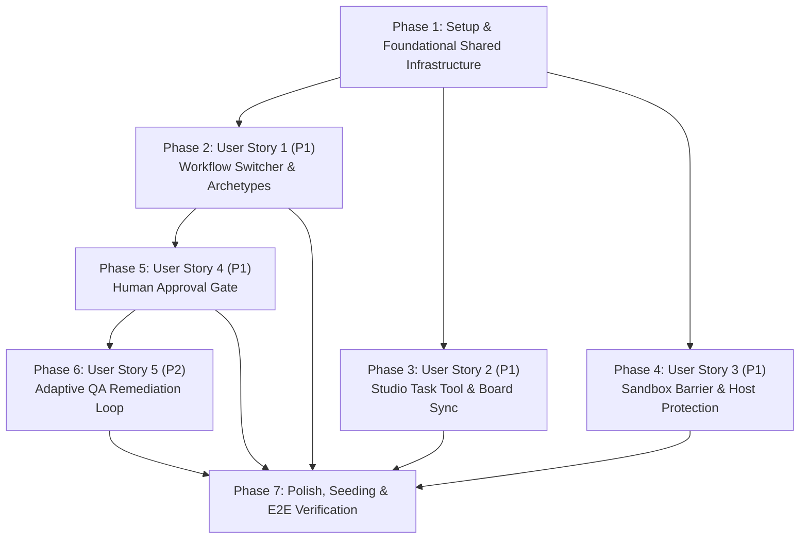

# Tasks: Dual-Mode Multi-Agent Orchestration (Linear Pipeline & Hierarchical Supervisor with Board Sync)

**Input**: Design documents from `/specs/009-dual-mode-orchestration/`  
**Prerequisites**: [plan.md](./plan.md) (required), [spec.md](./spec.md) (required), [research.md](./research.md), [data-model.md](./data-model.md), [contracts/](./contracts/), [quickstart.md](./quickstart.md)  
**Tests**: Included as specified in implementation plan and quickstart validation guide.  
**Organization**: Tasks are grouped by user story to enable independent implementation and testing of each story.

---

## Format: `[ID] [P?] [Story] Description`

- **[P]**: Can run in parallel (different files, no dependencies on incomplete tasks)
- **[Story]**: Which user story this task belongs to (e.g. `[US1]`, `[US2]`, `[US3]`, `[US4]`, `[US5]`)
- Setup and Polish phases do NOT have story labels.
- Include exact file paths in every task description.

---

## Phase 1: Setup & Foundational Shared Infrastructure

**Purpose**: Core types, archetype contracts, outcome envelopes, and shared interfaces that MUST be complete before ANY user story can be implemented.

**⚠️ CRITICAL**: No user story work can begin until this phase is complete and `@multi-agent/types` is built.

- [x] T001 [P] Define `WorkflowArchetypeCategory = "linear-pipeline" | "hierarchical-supervisor"`, `WorkflowRecursionGuardConfig` (`maxIterations` minimum 1 maximum 10 default 3, `routeKey: string`, `fallbackBranch: string`), and `WorkflowArchetypeConfig` (`category: WorkflowArchetypeCategory`, `supervisorHubNodeId?: string`, `maxExecutionSteps?: number` minimum 1 maximum 5000 default 1000, `recursionGuards?: WorkflowRecursionGuardConfig[]`, `humanApprovalGateRequired?: boolean`) in `packages/types/src/archetype.ts`
- [x] T002 [P] Define `SupervisorActionRoute = "audit_spec" | "consolidate" | "await_approval" | "implement_spec" | "qa_verify" | "complete" | "loop_limit_exceeded" | "fail"`, `IdentifiedGap` (`specCode: string`, `title: string`, `severity: "critical" | "major" | "minor"`, `description: string`, `missingFiles?: string[]`, `suggestedFix?: string`), `SpecAuditResultPayload` (`completenessScore` 0.0 to 100.0), `ConsolidatedGapReport`, `QAVerificationResult`, and `SupervisorOutcomeEnvelope` in `packages/types/src/supervisorOutcome.ts`
- [x] T003 [P] Define `HumanApprovalGateConfig` (`approvalType: "required"`, `timeoutSeconds: number`, `requiredRoles: ("admin" | "project_manager" | "lead_architect")[]`, `onTimeout: "fail_closed"`, `allowedDecisions: ("approved" | "rejected" | "needs_clarification")[]`), `HumanApprovalInterruptContext`, and `HumanApprovalDecisionPayload` in `packages/types/src/approval.ts`
- [x] T004 [P] Define `StudioTaskToolAction = "query_tasks" | "update_task_status" | "assign_task" | "add_task_comment"`, `StudioTaskQueryInput` (`limit` min 1 max 100 default 20, `offset` min 0 default 0), `StudioTaskUpdateStatusInput` (`reason` maxLength 500), `StudioTaskAssignInput`, `StudioTaskAddCommentInput` (`content` maxLength 4000, `authorRole: "agent" | "system" | "user"` default `"agent"`), `StudioTaskToolSuccessResponse`, and `StudioTaskToolErrorResponse` with error codes (`"TASK_NOT_FOUND" | "INVALID_STATUS_TRANSITION" | "TENANT_ISOLATION_VIOLATION" | "INVALID_INPUT" | "DEPENDENCY_BLOCKED"`) in `src/tools/types.ts`
- [x] T005 [P] Define `SandboxExecutionPolicy` (`canonicalSandboxRoot: string`, `forbiddenHostPaths: string[]`, `allowedExecutables: string[]`, `processTimeoutMs: number`), `SandboxHostProtectionViolationError`, and `SandboxBoundaryViolationError` in `src/security/types.ts`
- [x] T006 Re-export archetype, supervisor outcome, and approval types, and extend `WorkflowDefinition` with optional fields `archetype?: WorkflowArchetypeCategory` and `archetypeConfig?: WorkflowArchetypeConfig` in `packages/types/src/index.ts`
- [x] T007 Build the `@multi-agent/types` package to produce up-to-date distribution files via `pnpm --filter @multi-agent/types build`

**Checkpoint**: Foundation ready - all shared types and contracts are compiled and available across packages.

---

## Phase 2: User Story 1 (P1) - Workflow Switcher & Dual Archetypes 🎯 MVP

**Goal**: An organization administrator or workflow operator navigating `/o/building-gap/org` can inspect and switch between the `Linear Spec-to-Code Pipeline` and `Hierarchical Supervisor Workflow` via `WorkflowSwitcher.tsx` with URL synchronization (`?workflowId=...`) and unsaved dirty state protection.

**Independent Test**: Navigate to `/o/building-gap/org`, select "Linear Spec-to-Code Pipeline" and "Hierarchical Supervisor Workflow" from the switcher dropdown, verify that the canvas switches between sequential and hub-and-spoke topologies, verify that URL deep linking updates with `?workflowId=`, and confirm that dirty state prompts for confirmation before switching.

### Tests for User Story 1

- [x] T008 [P] [US1] Author contract and validation tests verifying `linear-pipeline` and `hierarchical-supervisor` definitions against `contracts/workflow-archetype.schema.json` in `tests/workflowArchetypeSchema.test.ts`
- [x] T009 [P] [US1] Author unit tests for `WorkflowSwitcher` component verifying multi-workflow dropdown rendering with archetype labels, client-side URL synchronization (`?workflowId=...`), and dirty-state confirmation prompt in `tests/workflowSwitcher.test.ts`

### Implementation for User Story 1

- [x] T010 [US1] Implement archetype-aware graph validation in `apps/server/src/compiler/validation.ts` validating acyclic DAG constraints for `linear-pipeline` and validating presence of `supervisorHubNodeId`, condition routing nodes, and recursion guard configuration for `hierarchical-supervisor`
- [x] T011 [US1] Update `apps/web/src/components/workflow/WorkflowSwitcher.tsx` to display archetype badges (`Linear Pipeline` / `Hierarchical Supervisor`) beside workflow names, synchronize URL query parameter `?workflowId=` via `router.push`, and enforce `canLeave()` dirty confirmation prompt before switching
- [x] T012 [US1] Update `apps/web/src/components/workflow/WorkflowEditor.tsx` to listen for `workflowId` search parameter changes, invoke `workflowService.getWorkflow(workflowId)`, and re-initialize `useWorkflowStore` without triggering full page reloads
- [x] T013 [US1] Add backward-compatibility fallback in `apps/server/src/compiler/workflowCompiler.ts` ensuring workflow definitions with undefined `archetype` default safely to `"linear-pipeline"` with zero regression for legacy workflows

**Checkpoint**: User Story 1 complete and independently testable - both archetypes coexist in the UI and can be switched dynamically.

---

## Phase 3: User Story 2 (P1) - Studio Task Tool & Bi-directional Board Synchronization

**Goal**: The Lead Orchestrator agent programmatically interacts with the Studio Task Board via `studio_task_tool` to query queued tasks, claim and transition task statuses (`queued` -> `in_progress` -> `in_review` -> `done`), assign specialist agents, and post structured audit findings as task comments with strict tenant isolation.

**Independent Test**: Seed tasks in `queued` status, invoke `studio_task_tool` operations (`query_tasks`, `update_task_status`, `assign_task`, `add_task_comment`), verify valid lifecycle transitions and comment records on the Kanban board, and confirm that cross-tenant access attempts fail closed with `TENANT_ISOLATION_VIOLATION`.

### Tests for User Story 2

- [x] T014 [P] [US2] Author contract tests validating `studio_task_tool` input/output payloads against `contracts/studio-task-tool.openapi.yaml` in `tests/studioTaskToolContract.test.ts`
- [x] T015 [P] [US2] Author unit and integration tests for `StudioTaskToolExecutor` in `tests/studioTaskTool.test.ts` testing task queries, status transitions across lifecycle (`queued`, `in_progress`, `in_review`, `done`, `failed`, `paused`), structured comment creation with author role attribution (`agent`, `system`, `user`), and fail-closed tenant isolation enforcement

### Implementation for User Story 2

- [x] T016 [US2] Implement `StudioTaskToolExecutor` in `src/tools/studioTaskToolExecutor.ts` implementing `ToolExecutor` and dispatching actions `query_tasks`, `update_task_status`, `assign_task`, and `add_task_comment` via `StudioStore` and `canTransitionStatus`
- [x] T017 [US2] Implement strict tenant isolation checks in `src/tools/studioTaskToolExecutor.ts` enforcing `task.tenant_id === context.credentialPrincipal.tenantId` and returning `TENANT_ISOLATION_VIOLATION` on foreign tenant access attempts
- [x] T018 [US2] Register `studio_task_tool` in `src/tools/toolExecutorFactory.ts` and export it in `src/tools/index.ts`
- [x] T019 [US2] Configure system prompts and tool execution bindings for `Spec Delivery Lead Orchestrator` to invoke `studio_task_tool` for task intake and board synchronization in `src/agents/personas/leadOrchestrator.ts`

**Checkpoint**: User Story 2 complete and independently testable - the Lead Orchestrator can programmatically query and synchronize tasks with the Studio board under tenant isolation.

---

## Phase 4: User Story 3 (P1) - Sandboxed Workspace Isolation & Host Repository Protection

**Goal**: Confine all agent file inspection, test execution, and code generation strictly to `workspaces/building-management-sandbox`, strictly protecting host repository `/home/hossein/Desktop/projects/building-management` from write or delete access and blocking path traversals fail-closed.

**Independent Test**: Launch file read/write operations inside `workspaces/building-management-sandbox` and verify success; execute write attempts targeting `/home/hossein/Desktop/projects/building-management` or path traversal escapes (`../../`) and verify that `SandboxHostProtectionViolationError` is thrown and host `git status --short` remains 0 changes.

### Tests for User Story 3

- [x] T020 [P] [US3] Author security isolation and boundary tests in `tests/sandboxExecutionBarrier.test.ts` verifying path canonicalization, sandbox write confinement, host repository write denial, traversal rejection (`../../`), and confirming host repository git status is 100% clean post-execution

### Implementation for User Story 3

- [x] T021 [US3] Implement `SandboxExecutionBarrier` in `src/security/sandboxExecutionBarrier.ts` using `fs.realpathSync.native` and `path.resolve` to enforce sandbox root confinement (`workspaces/building-management-sandbox`) and block forbidden host paths (`/home/hossein/Desktop/projects/building-management`), throwing `SandboxHostProtectionViolationError` and `SandboxBoundaryViolationError`
- [x] T022 [US3] Wire `SandboxExecutionBarrier` into `src/security/executionPolicy.ts` to assert agent `workspaceRoot` validity and block unauthorized file system mutations
- [x] T023 [US3] Integrate `SandboxExecutionBarrier` into subprocess execution in `src/security/workerRuntimeBarrier.ts` forcing CLI process `cwd` to `workspaces/building-management-sandbox` and denying commands targeting external paths
- [x] T024 [US3] Export `SandboxExecutionBarrier` and security error types in `src/security/index.ts`

**Checkpoint**: User Story 3 complete and independently testable - all agent operations execute within the sandbox and the host repository is provably protected.

---

## Phase 5: User Story 4 (P1) - Mandatory Human Approval Gate

**Goal**: Halt autonomous workflow progression after gap report consolidation at a mandatory Human Approval Gate using LangGraph `interrupt()`, requiring explicit human authorization (`approved`, `rejected`, `needs_clarification`) before any downstream remediation engineer can modify code files in the sandbox.

**Independent Test**: Execute the supervisor workflow through intake, audit, and consolidation, verify execution pauses with status `waiting_for_human` at node `Human Approval Gate`, confirm that remediation nodes remain unexecuted, verify that an approved decision resumes remediation, and verify that a rejected decision terminates cleanly with zero source code mutations.

### Tests for User Story 4

- [x] T025 [P] [US4] Author unit and lifecycle tests for the Human Approval Gate in `tests/humanApprovalGate.test.ts` testing LangGraph `interrupt()` pause, checkpoint persistence in `RunStore`, downstream node execution blocking while pending, approval resumption, rejection clean halt, and timeout fail-closed behavior

### Implementation for User Story 4

- [x] T026 [US4] Implement approval node compilation in `apps/server/src/compiler/workflowCompiler.ts` using LangGraph `interrupt()` with `HumanApprovalInterruptContext` containing `gateId`, `runId`, `nodeId`, `consolidatedGapReport`, and timeout bounds
- [x] T027 [US4] Update execution lifecycle in `apps/server/src/runtime/runExecutor.ts` to persist execution checkpoints on approval interruption, update run status to `waiting_for_human`, and handle approval/rejection decision endpoints (`/api/runs/:runId/approve`, `/api/runs/:runId/reject`)
- [x] T028 [US4] Implement clean-halt rejection branch in `apps/server/src/runtime/runExecutor.ts` transitioning tasks to `paused`, recording reviewer decision notes in audit comments, and exiting without invoking code implementation nodes
- [x] T029 [US4] Implement approval review modal in `apps/web/src/components/workflow/ApprovalGateModal.tsx` displaying the `ConsolidatedGapReport` (total user stories, audited count, average completeness score, critical gaps, and remediation plan summary) with Approve and Reject actions

**Checkpoint**: User Story 4 complete and independently testable - no code mutations can execute without explicit human approval.

---

## Phase 6: User Story 5 (P2) - Adaptive QA Feedback & Remediation Loop

**Goal**: In the supervisor delivery workflow, when code remediation produces failing QA tests, the supervisor receives structured failure evidence and dynamically routes execution back to the remediation engineer with per-route recursion guards (maximum 3 iterations), escalating on limit exhaustion.

**Independent Test**: Introduce an intentional defect in sandbox code causing QA verification tests to fail, verify that QA verifier returns structured failure evidence to the supervisor, confirm that the supervisor routes back to the remediation engineer for iterations 1 and 2, verify that passing tests route to completion, and verify that reaching the 3rd failed iteration triggers `loop_limit_exceeded` fallback, marking the task `paused` with diagnostic logs.

### Tests for User Story 5

- [x] T030 [P] [US5] Author unit and integration tests for cyclical feedback routing and recursion guards in `tests/adaptiveQALoop.test.ts` verifying loop state tracking, feedback re-routing, recursion limit enforcement at max 3 iterations, and fallback branch activation on limit exhaustion

### Implementation for User Story 5

- [x] T031 [US5] Extend `RuntimeState` with `loopIterations: Record<string, number>` in `apps/server/src/runtime/graphRunner.ts` to track cycle counts per route key
- [x] T032 [US5] Implement conditional routing function with recursion guardrails in `apps/server/src/compiler/workflowCompiler.ts` evaluating `SupervisorOutcomeEnvelope.nextAction`, checking `iterationCount >= maxIterations` (default 3), and routing to `fallbackBranch` (`"loop_limit_exceeded"`) when limit is reached
- [x] T033 [US5] Implement `loop_limit_exceeded` handler node in `apps/server/src/runtime/runExecutor.ts` posting diagnostic comments to the Studio task via `studio_task_tool`, updating task status to `paused`, and emitting `node.loop_limit_reached` telemetry event
- [x] T034 [US5] Configure condition routing edges and retry bounds for `Delivery QA Verifier` and `Gap Implementation Engineer` in `src/agents/personas/qaVerifier.ts`

**Checkpoint**: User Story 5 complete and independently testable - iterative QA remediation loops self-correct within safety boundaries and terminate safely at recursion limits.

---

## Phase 7: Polish, Seed Script for `org-building-gap`, and End-to-End Verification Test Suite

**Purpose**: Improvements that affect multiple user stories, database seeding for `org-building-gap`, and comprehensive verification suites.

- [x] T035 [P] Create database seed script `src/studio/seeds/buildingGapOrgSeed.ts` configuring tenant `org-building-gap`, project `project-building-gap`, workspace `ws-building-sandbox`, 5 specialist agent personas (`Spec Delivery Lead Orchestrator`, `Spec & Code Gap Auditor`, `Gap Report Consolidator`, `Gap Implementation Engineer`, `Delivery QA Verifier`), both workflow definitions (`linear-spec-pipeline` and `supervisor-gap-delivery-workflow`), and all 42 queued building management user stories
- [x] T036 Author end-to-end integration test suite `tests/dualModeOrchestration.test.ts` validating all scenarios from `quickstart.md` (switcher coexistence, board synchronization, sandbox containment, approval gates, and recursion limits)
- [x] T037 [P] Execute project-wide TypeScript compilation check across root, `packages/types`, `apps/server`, and `apps/web` via `npx tsc --noEmit`
- [x] T038 Execute the complete test suite via `pnpm test --runInBand` and verify all tests pass with zero regressions
- [x] T039 [P] Update documentation in `specs/009-dual-mode-orchestration/README.md` and `docs/architecture.md` detailing dual-mode archetypes, task tool usage, and sandbox security policies

---

## Dependencies & Execution Order

### Phase Dependencies

- **Phase 1 (Setup & Foundational)**: No dependencies - can start immediately. BLOCKS all user stories.
- **Phase 2 (User Story 1 - P1)**: Depends on Phase 1 completion. Provides UI switcher and archetype foundation.
- **Phase 3 (User Story 2 - P1)**: Depends on Phase 1 completion. Can proceed in parallel with US1.
- **Phase 4 (User Story 3 - P1)**: Depends on Phase 1 completion. Can proceed in parallel with US1 and US2.
- **Phase 5 (User Story 4 - P1)**: Depends on Phase 1 and Phase 2. Can proceed in parallel with US2 and US3.
- **Phase 6 (User Story 5 - P2)**: Depends on Phase 1, Phase 2, and Phase 5 (remediation loop runs downstream of approval gate).
- **Phase 7 (Polish & Seeding)**: Depends on all user stories (Phases 1-6) being complete.



### User Story Dependencies

- **User Story 1 (P1)**: Depends only on Phase 1. No dependencies on other user stories.
- **User Story 2 (P1)**: Depends only on Phase 1. No dependencies on US1, US3, US4, or US5.
- **User Story 3 (P1)**: Depends only on Phase 1. Can run in parallel with US1 and US2.
- **User Story 4 (P1)**: Depends on Phase 1 and Phase 2 (compiler integration). Positioned upstream of remediation.
- **User Story 5 (P2)**: Depends on Phase 1, Phase 2, and Phase 5 (QA loop governs remediation after approval).

### Within Each User Story

1. Write contract and unit tests first; ensure they fail before implementation.
2. Implement core models, validators, and security guards.
3. Implement services, executors, and runtime compiler extensions.
4. Implement UI components and endpoint handlers.
5. Verify tests pass and checkpoint criteria are met before progressing.

---

## Parallel Execution Opportunities

### Parallel Opportunities in Phase 1 (Foundational)
```bash
# Can run simultaneously (different files):
Task T001: packages/types/src/archetype.ts
Task T002: packages/types/src/supervisorOutcome.ts
Task T003: packages/types/src/approval.ts
Task T004: src/tools/types.ts
Task T005: src/security/types.ts
```

### Parallel Opportunities in User Story 1
```bash
# Can run simultaneously:
Task T008: tests/workflowArchetypeSchema.test.ts
Task T009: tests/workflowSwitcher.test.ts
```

### Parallel Opportunities in User Story 2
```bash
# Can run simultaneously:
Task T014: tests/studioTaskToolContract.test.ts
Task T015: tests/studioTaskTool.test.ts
```

### Parallel Opportunities in User Story 3
```bash
# Can run simultaneously with other stories:
Task T020: tests/sandboxExecutionBarrier.test.ts
Task T021: src/security/sandboxExecutionBarrier.ts
```

### Parallel Opportunities in User Story 4
```bash
# Can run simultaneously:
Task T025: tests/humanApprovalGate.test.ts
Task T029: apps/web/src/components/workflow/ApprovalGateModal.tsx
```

### Parallel Opportunities in User Story 5
```bash
# Can run simultaneously:
Task T030: tests/adaptiveQALoop.test.ts
Task T034: src/agents/personas/qaVerifier.ts
```

### Parallel Opportunities in Phase 7 (Polish)
```bash
# Can run simultaneously:
Task T035: src/studio/seeds/buildingGapOrgSeed.ts
Task T037: Typecheck (npx tsc --noEmit)
Task T039: specs/009-dual-mode-orchestration/README.md & docs/architecture.md
```

---

## Implementation Strategy

### MVP First (User Story 1 Only)

1. Complete **Phase 1: Setup & Foundational Shared Infrastructure** (`@multi-agent/types`, outcome envelopes, tool contracts).
2. Complete **Phase 2: User Story 1 (P1)**:
   - Graph validation for `linear-pipeline` vs `hierarchical-supervisor`.
   - `WorkflowSwitcher.tsx` with archetype labels, dirty state check, and `?workflowId=` deep linking.
   - `WorkflowEditor.tsx` dynamic loading.
3. **STOP and VALIDATE**: Test User Story 1 independently in browser on `/o/building-gap/org`.
4. Deploy / Demo the coexistence of both archetypes.

### Incremental Delivery (Stories 2 through 5)

1. **Increment 1 (MVP)**: Workflow Switcher & Dual Archetype Coexistence (User Story 1).
2. **Increment 2**: Studio Task Tool & Bi-directional Board Sync (User Story 2) - gives agents programmatic control of the Kanban board.
3. **Increment 3**: Sandboxed Workspace Isolation & Host Repo Protection (User Story 3) - guarantees complete host repository safety before any agent file access.
4. **Increment 4**: Mandatory Human Approval Gate (User Story 4) - ensures zero code modifications can occur without human approval.
5. **Increment 5**: Adaptive QA Feedback Loop with Recursion Guards (User Story 5) - allows self-correcting remediation bounded by max 3 iterations.
6. **Increment 6**: Full Seeding (`org-building-gap`, 42 stories) and E2E Verification Suite (Phase 7).

### Parallel Team Strategy

With multiple developers:
1. Team completes Phase 1 together.
2. Once Phase 1 is built and published:
   - **Developer A**: User Story 1 (UI Switcher, canvas coexistence, archetype validation).
   - **Developer B**: User Story 2 (`studio_task_tool` executor, board sync, tenant isolation).
   - **Developer C**: User Story 3 (`SandboxExecutionBarrier`, canonical paths, host repo protection).
3. Once US1 and US3 are merged:
   - **Developer A & B**: User Story 4 (Human Approval Gate, LangGraph `interrupt()`).
   - **Developer C**: User Story 5 (Adaptive QA loop & recursion guards).
4. Team converges on Phase 7: seeding `org-building-gap` and running full E2E test suites.
