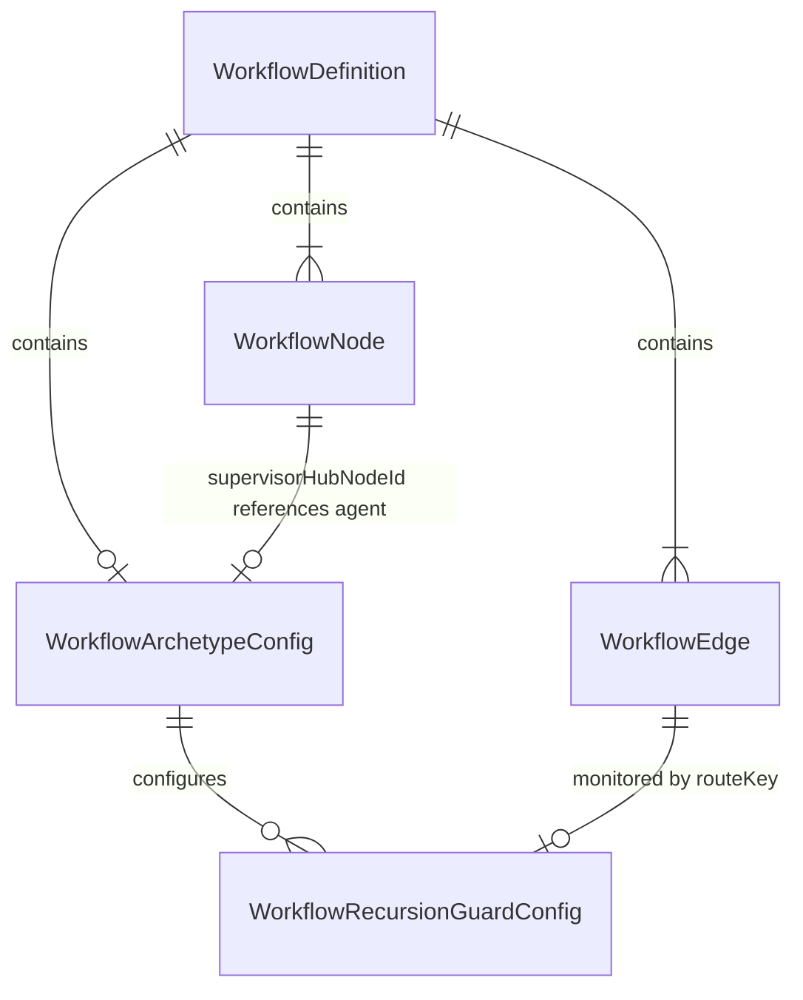
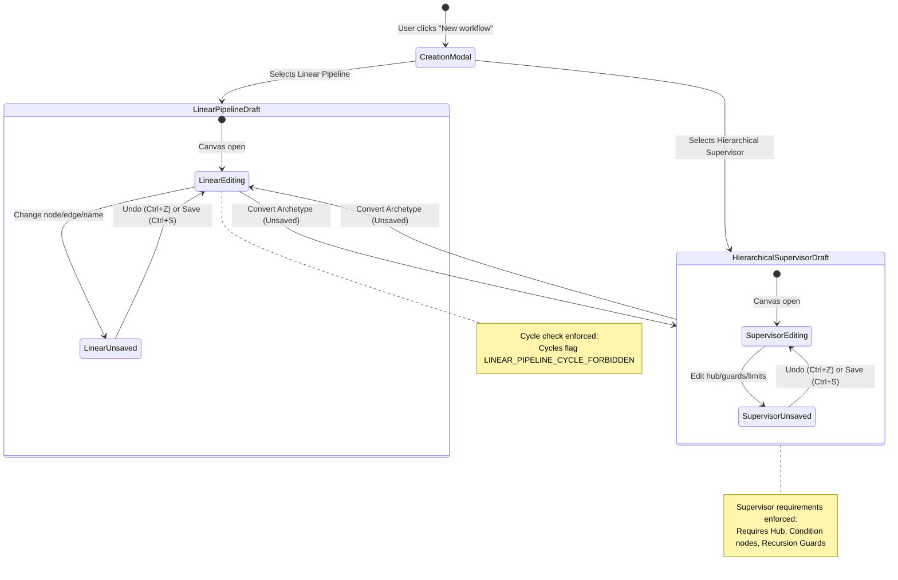

# Data Model: Explicit Workflow Archetype Selection and Configuration

**Feature Branch**: `010-workflow-archetype-selection`  
**Date**: 2026-11-03  
**Status**: Completed  

---

## Entity Architecture & Relationships

---

## Core Entities

### 1. `WorkflowDefinition` (Extended)

The primary persisted entity representing a multi-agent workflow in Agent Studio.

| Field | Type | Required | Description | Validation Rules |
| :--- | :--- | :---: | :--- | :--- |
| `id` | `string` | Yes | Unique workflow identifier. | Pattern: `^[a-zA-Z0-9_-]+$` |
| `name` | `string` | Yes | Human-readable workflow display name. | Length: 1–200 characters |
| `archetype` | `WorkflowArchetypeCategory` | No | Explicit structural category classification. | Enum: `"linear-pipeline" \| "hierarchical-supervisor"`. If undefined, resolved via fallback. |
| `archetypeConfig` | `WorkflowArchetypeConfig` | No | Detailed archetype configuration container. | Must be consistent with `archetype`. |
| `nodes` | `WorkflowNode[]` | Yes | Nodes comprising the graph. | Minimum 1 node (draft) or 2 (execution). |
| `edges` | `WorkflowEdge[]` | Yes | Connections between nodes. | Valid node endpoint references. |
| `tenantId` | `string` | No | Organization identifier for multi-tenant isolation. | Scoped to authenticated user's organization. |
| `ownerId` | `string` | No | User ID of the workflow creator. | Valid user identifier. |
| `updatedAt` | `string` | Yes | ISO 8601 timestamp of last modification. | Valid datetime. |

---

### 2. `WorkflowArchetypeConfig`

Detailed configuration block governing execution parameters, guardrails, and role bindings.

| Field | Type | Required | Default | Description | Validation Rules |
| :--- | :--- | :---: | :---: | :--- | :--- |
| `category` | `WorkflowArchetypeCategory` | Yes | `"linear-pipeline"` | Declared archetype category. | Must equal `definition.archetype` when both are defined. |
| `supervisorHubNodeId` | `string` | Conditional | `undefined` | ID of the coordinating agent node. | **Mandatory** when `category === "hierarchical-supervisor"`. Node must exist and have `type: "agent"`. |
| `maxExecutionSteps` | `number` | No | `1000` | Server-enforced step execution ceiling. | Integer between `1` and `5000`. |
| `recursionGuards` | `WorkflowRecursionGuardConfig[]` | No | `[]` | Route-specific loop termination safeguards. | Required if graph has feedback cycles in supervisor mode. |
| `humanApprovalGateRequired` | `boolean` | No | `false` (linear), `true` (supervisor) | Whether code mutations require human sign-off. | If `true`, graph must contain an `approval` node intercepting code modifications. |

---

### 3. `WorkflowRecursionGuardConfig`

A granular loop termination rule monitoring a specific feedback route in a hierarchical supervisor graph.

| Field | Type | Required | Default | Description | Validation Rules |
| :--- | :--- | :---: | :---: | :--- | :--- |
| `routeKey` | `string` | Yes | - | Identifier of the monitored cyclic route. | Non-empty string (e.g. `"qa_verify->implement_spec"` or condition branch name). |
| `maxIterations` | `number` | Yes | `3` | Maximum allowed cycles before exiting the loop. | Integer between `1` and `10`. |
| `fallbackBranch` | `string` | Yes | `"loop_limit_exceeded"` | Condition branch key followed when limit is hit. | Must match a declared branch on a condition node and reach a terminal exit node. |

---

### 4. `CreateWorkflowInput`

Client input contract submitted when instantiating a new workflow via the creation modal.

| Field | Type | Required | Default | Description |
| :--- | :--- | :---: | :---: | :--- |
| `name` | `string` | Yes | `"Untitled Workflow"` | Workflow name. Trimmed string, length 1–200. |
| `archetype` | `WorkflowArchetypeCategory` | Yes | `"linear-pipeline"` | Explicit archetype chosen by operator. |

---

### 5. `ArchetypeOptionDescriptor`

Static UI descriptor used to render archetype options in creation and conversion dialogs.

| Field | Type | Description |
| :--- | :--- | :--- |
| `id` | `WorkflowArchetypeCategory` | Machine identifier (`"linear-pipeline"` or `"hierarchical-supervisor"`). |
| `label` | `string` | Formatted display label (`"Linear Pipeline"` or `"Hierarchical Supervisor"`). |
| `badgeClass` | `string` | Tailwind CSS styling for badge chips. |
| `description` | `string` | Plain-language explanation of execution behavior and topology constraints. |

---

## State Lifecycle & Transitions

---

## Validation Invariants & Issue Codes

| Issue Code | Severity | Trigger Invariant | UI Association |
| :--- | :---: | :--- | :--- |
| `INVALID_ARCHETYPE` | Error | Value not in enum or `archetype !== archetypeConfig.category` | Archetype selector / Header badge |
| `LINEAR_PIPELINE_CYCLE_FORBIDDEN` | Error | Graph contains directed cycles while active archetype is `linear-pipeline` | Participating cycle nodes & edges |
| `MISSING_SUPERVISOR_HUB` | Error | Active archetype is `hierarchical-supervisor` but `supervisorHubNodeId` is missing | Supervisor hub dropdown in Overview |
| `INVALID_SUPERVISOR_HUB` | Error | `supervisorHubNodeId` does not reference an existing `agent` node | Supervisor hub dropdown in Overview |
| `MISSING_ROUTING_NODES` | Error | Active archetype is `hierarchical-supervisor` but graph has zero `condition` nodes | Canvas / Overview panel |
| `UNGUARDED_CYCLE` | Error | Graph contains feedback cycles in supervisor mode with no matching recursion guard | Recursion guard manager / Cycle edges |
| `INVALID_RECURSION_GUARD` | Error | Guard has empty `routeKey`, non-integer or out-of-bounds `maxIterations` (<1 or >10) | Recursion guard row in Overview |
| `FALLBACK_NOT_WIRED` | Error | `fallbackBranch` is not present on any condition node or cannot reach a terminal exit | Recursion guard row / Condition node |
| `MISSING_APPROVAL_GATE` | Error | `humanApprovalGateRequired` is `true` but graph has zero `approval` nodes | Approval gate toggle / Canvas |
| `APPROVAL_GATE_BYPASS` | Error | `humanApprovalGateRequired` is `true` but code-mutation route bypasses approval | Conditional edge to code mutation node |
| `CYCLE_REQUIRES_GUARDRAIL` | Warning | Untyped legacy workflow contains cycles bounded by server step limits | Node / Status bar (Warning only) |
