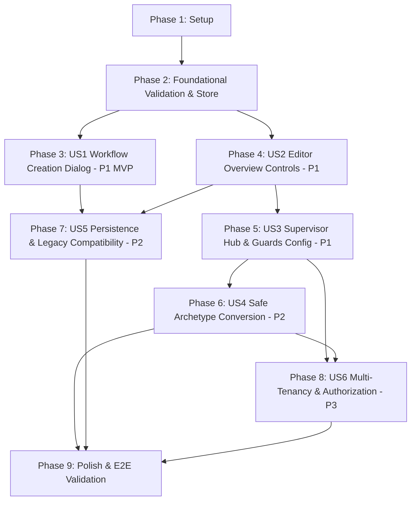

# Tasks: Explicit Workflow Archetype Selection and Configuration

**Input**: Design documents from `specs/010-workflow-archetype-selection/` (`spec.md`, `plan.md`, `research.md`, `data-model.md`, `contracts/`, `quickstart.md`)  
**Prerequisites**: `spec.md` (user stories P1–P3), `plan.md`, `data-model.md`, `contracts/`  
**Approach**: Test-Driven Development (TDD) — all test tasks MUST be written first and fail before implementing the corresponding feature code.  

---

## Phase 1: Setup (Shared Types & Contracts)

**Purpose**: Establish core UI archetype contracts, type descriptors, and default configurations shared between server and web client.

- [x] T001 Export UI archetype contracts and descriptors (`ARCHETYPE_DESCRIPTORS`, `CreateWorkflowDialogSubmitPayload`, `WorkflowStoreArchetypeActions`, `ArchetypeValidationState`) in `specs/010-workflow-archetype-selection/contracts/ui-archetype-controls.contract.ts`
- [x] T002 [P] Extend `@multi-agent/types` in `packages/types/src/archetype.ts` with archetype metadata descriptors, helper functions (`getArchetypeDescriptor`, `isWorkflowArchetypeValid`), and export through `packages/types/src/index.ts`
- [x] T003 [P] Verify monorepo typecheck clean for shared types via `npx tsc --noEmit`

---

## Phase 2: Foundational (Client Validation Parity & Store Infrastructure)

**Purpose**: Core client-side validation engine and Zustand store action signatures that block all user stories. Must be complete before user story implementation.

> **CRITICAL**: No user story implementation can begin until this foundational phase is complete.

### Tests for Foundation (TDD First)
- [x] T004 [P] Author unit test suite for client-side archetype validation in `tests/clientWorkflowValidation.test.ts` verifying issue codes `INVALID_ARCHETYPE`, `LINEAR_PIPELINE_CYCLE_FORBIDDEN`, `MISSING_SUPERVISOR_HUB`, `INVALID_SUPERVISOR_HUB`, `MISSING_ROUTING_NODES`, `UNGUARDED_CYCLE`, `INVALID_RECURSION_GUARD`, `FALLBACK_NOT_WIRED`, `MISSING_APPROVAL_GATE`, and `APPROVAL_GATE_BYPASS`
- [x] T005 [P] Author unit test suite for workflow store archetype mutations in `tests/workflowStoreArchetype.test.ts` verifying `setWorkflowArchetype`, `updateSupervisorConfig`, `addRecursionGuard`, `updateRecursionGuard`, `removeRecursionGuard`, history recording (undo/redo flags), and `isDirty` transitions

### Implementation for Foundation
- [x] T006 Implement client-side `validateArchetype` function in `apps/web/src/lib/workflow/validation.ts` mirroring `apps/server/src/compiler/validation.ts`, validating:
  - `archetype`: "Enum: 'linear-pipeline' | 'hierarchical-supervisor'"
  - `category`: "Must equal definition.archetype when both are defined; reject mismatch with INVALID_ARCHETYPE"
  - `LINEAR_PIPELINE_CYCLE_FORBIDDEN`: "Graph contains directed cycles while active archetype is 'linear-pipeline' and explicitly declared"
  - `MISSING_SUPERVISOR_HUB`: "Active archetype is 'hierarchical-supervisor' but supervisorHubNodeId is missing"
  - `INVALID_SUPERVISOR_HUB`: "supervisorHubNodeId must exist and have type: 'agent'"
  - `MISSING_ROUTING_NODES`: "Active archetype is 'hierarchical-supervisor' but graph has zero condition nodes"
  - `UNGUARDED_CYCLE`: "Graph contains feedback cycles in supervisor mode with no matching recursion guard"
  - `INVALID_RECURSION_GUARD`: "routeKey non-empty string; maxIterations integer between 1 and 10; fallbackBranch non-empty string"
  - `FALLBACK_NOT_WIRED`: "fallbackBranch must match a declared branch on a condition node and reach a terminal exit node"
  - `MISSING_APPROVAL_GATE` & `APPROVAL_GATE_BYPASS`: "humanApprovalGateRequired is true but graph lacks approval node or route implement_spec bypasses approval"
- [x] T007 Extend `WorkflowStoreState` in `apps/web/src/store/useWorkflowStore.ts` with action interfaces (`setWorkflowArchetype`, `updateSupervisorConfig`, `addRecursionGuard`, `updateRecursionGuard`, `removeRecursionGuard`), integrating with `withDefinition`, `history.push`, and `syncHistoryFlags`
- [x] T008 Run foundational test suites (`pnpm test tests/clientWorkflowValidation.test.ts tests/workflowStoreArchetype.test.ts`) to confirm all foundational tests pass green

**Checkpoint**: Foundation ready — client validation parity and store actions are fully verified. User story implementation can now begin.

---

## Phase 3: User Story 1 - Explicit Workflow Creation with Archetype Selection (Priority: P1) 🎯 MVP

**Goal**: An operator clicking "New workflow" is presented with a creation modal offering Linear Pipeline (default) and Hierarchical Supervisor with concise behavioral descriptions, initializing the chosen archetype and persisting it.

**Independent Test**: Open the switcher, click "New workflow", select "Hierarchical Supervisor", enter name "Test Supervisor", click Create, and verify the editor loads with the purple supervisor badge, supervisor Overview panel, and persisted archetype.

### Tests for User Story 1 (TDD First)
- [x] T009 [P] [US1] Author component tests for `CreateWorkflowDialog` in `tests/createWorkflowDialog.test.tsx` verifying:
  - Rendering with "Linear Pipeline" pre-selected by default
  - Displaying behavioral descriptions: "Sequential, deterministic multi-agent pipeline executing an acyclic directed graph" vs "Hub-and-spoke multi-agent coordination architecture with dynamic condition routing and recursion guardrails"
  - Validating workflow name: "Length: 1–200 characters, trimmed string"
  - Submitting `{ name, archetype }` payload
  - Keyboard navigation (Enter to submit, Escape to close)
- [x] T010 [P] [US1] Author integration tests in `tests/workflowCreationLifecycle.test.ts` verifying API client and store initialization with selected archetype upon creation

### Implementation for User Story 1
- [x] T011 [US1] Create modal dialog component `apps/web/src/components/workflow/CreateWorkflowDialog.tsx` implementing `CreateWorkflowDialogProps`:
  - Input field for workflow name with validation ("Length: 1–200 characters, trimmed string")
  - Radio/card selector for archetype (`"linear-pipeline"` default, `"hierarchical-supervisor"`) with badges and descriptions from `ARCHETYPE_DESCRIPTORS`
  - Accessible dialog overlay with Escape key listener and Tab trap
- [x] T012 [US1] Update `apps/web/src/components/workflow/WorkflowSwitcher.tsx` to replace `window.prompt` with `CreateWorkflowDialog`:
  - Enforce `canLeave()` dirty confirmation prompt before opening dialog
  - Pass `{ name, archetype }` to `workflowService.createWorkflow(name, archetype)`
  - Navigate to `/org?workflowId=${encodeURIComponent(created.id)}`
- [x] T013 [US1] Update `apps/web/src/services/workflowService.ts` and `apps/server/src/api/studio/workflowRoutes.ts` to accept optional `archetype` parameter in `createWorkflow(name, archetype)` and `POST /workflows`, initializing `createEmptyDefinition(name)` with the requested archetype
- [x] T014 [US1] Update `apps/web/src/components/workflow/EditorToolbar.tsx` to disable the "Run" button when a newly created workflow is an incomplete draft with blocking validation errors (`hasErrors = issues.some(i => i.severity === "error")`)
- [x] T015 [US1] Run User Story 1 test suites (`pnpm test tests/createWorkflowDialog.test.tsx tests/workflowCreationLifecycle.test.ts`) to verify green status

**Checkpoint**: User Story 1 is functional and testable independently. Operators can create workflows with explicit archetype selection.

---

## Phase 4: User Story 2 - Inspecting & Editing Workflow Archetype in the Editor (Priority: P1)

**Goal**: An authorized operator inspecting an existing workflow can see its active effective archetype in the Overview panel, explicitly change it, track unsaved changes (`isDirty`), undo/redo modifications, and be protected against accidental navigation loss.

**Independent Test**: Load an existing workflow, verify the Overview panel displays the effective archetype, change the archetype to Hierarchical Supervisor, verify `isDirty` pulses `Unsaved`, press `Ctrl+Z` to verify Undo restores the previous archetype, press `Ctrl+Y` to Redo, and verify attempting to switch workflows prompts confirmation.

### Tests for User Story 2 (TDD First)
- [x] T016 [P] [US2] Author component tests in `tests/workflowArchetypeEditor.test.tsx` verifying:
  - Overview panel displays active archetype badge and description
  - Changing archetype updates header badge reactively
  - Changing archetype transitions store `isDirty` to `true`
  - Triggering `undo()` restores previous archetype and prior configuration
  - Triggering `redo()` reapplies archetype change
  - Workflow identity (`id`, `name`, `tenantId`, `ownerId`), nodes, edges, and configurations are preserved 100%
  - Graph edits (adding condition node or edge) do NOT automatically alter the workflow archetype
- [x] T017 [P] [US2] Author integration tests in `tests/workflowNavigationProtection.test.ts` verifying `canLeave()` prompts confirmation when switching workflows or leaving with pending archetype edits

### Implementation for User Story 2
- [x] T018 [US2] Create `ArchetypeSection` component in `apps/web/src/components/workflow/properties/ArchetypeForms.tsx`:
  - Display effective archetype badge (`formatArchetypeLabel(resolveWorkflowArchetype(definition))`)
  - Select dropdown allowing explicit archetype switching between `"linear-pipeline"` and `"hierarchical-supervisor"`
  - Description box rendering behavioral summary and topology constraints from `ARCHETYPE_DESCRIPTORS`
- [x] T019 [US2] Integrate `ArchetypeSection` into `Overview` component in `apps/web/src/components/workflow/properties/panels.tsx`:
  - Mount above node count summary
  - Connect `onChange` to `useWorkflowStore.getState().setWorkflowArchetype(nextArchetype)`
- [x] T020 [US2] Verify `WorkflowSwitcher.tsx` dirty guard `canLeave = () => !dirty || window.confirm("Discard unsaved workflow changes?")` intercepts navigation and workflow selection changes when archetype has been modified
- [x] T021 [US2] Run User Story 2 test suites (`pnpm test tests/workflowArchetypeEditor.test.tsx tests/workflowNavigationProtection.test.ts`) to verify green status

**Checkpoint**: User Story 2 is functional. Operators can inspect and edit the active archetype with full Undo/Redo and dirty protection.

---

## Phase 5: User Story 3 - Hierarchical Supervisor Hub & Recursion Guard Configuration (Priority: P1)

**Goal**: In Hierarchical Supervisor mode, the Overview panel exposes configuration controls for selecting a supervisor hub agent node, configuring recursion guards (`routeKey`, `maxIterations`, `fallbackBranch`), setting execution limits, and toggling human approval gates.

**Independent Test**: In a supervisor workflow, add an Agent node, select it as the supervisor hub, add a recursion guard for a feedback loop with `maxIterations: 3` and a valid exit fallback branch, delete the hub node, verify localized error `INVALID_SUPERVISOR_HUB`, restore it via Undo, and verify the Run button enables.

### Tests for User Story 3 (TDD First)
- [x] T022 [P] [US3] Author component tests in `tests/supervisorConfigForms.test.tsx` verifying:
  - Hub selector lists only nodes where `node.type === "agent"`
  - Deleting the hub agent renders error border and message: "Selected hub node missing from canvas or not an agent"
  - Recursion guard manager supports adding, editing, and deleting guards
  - Clamping `maxIterations`: "Integer between 1 and 10, default 3"
  - Clamping `maxExecutionSteps`: "Integer between 1 and 5000, default 1000"
  - `fallbackBranch` selector populates from condition node branches leading to terminal exit
  - `humanApprovalGateRequired` toggle updates configuration and flags `MISSING_APPROVAL_GATE` if graph lacks approval node
- [x] T023 [P] [US3] Author integration test in `tests/supervisorExecutionGate.test.ts` verifying toolbar "Run" button is disabled whenever supervisor hub or recursion guards are invalid or missing

### Implementation for User Story 3
- [x] T024 [US3] Implement `SupervisorHubPicker` component in `apps/web/src/components/workflow/properties/ArchetypeForms.tsx`:
  - Filter available candidates from `definition.nodes.filter(n => n.type === "agent")`
  - Display current selection from `definition.archetypeConfig?.supervisorHubNodeId`
  - Render localized error state if `supervisorHubNodeId` references a non-existent or non-agent node
  - Connect selection to `updateSupervisorConfig({ supervisorHubNodeId: selectedId })`
- [x] T025 [US3] Implement `RecursionGuardsManager` component in `apps/web/src/components/workflow/properties/ArchetypeForms.tsx`:
  - List configured recursion guards with columns: Route, Max Iterations, Fallback Branch, Delete Action
  - "Add Guard" button inserting `{ routeKey: "feedback_loop", maxIterations: 3, fallbackBranch: "loop_limit_exceeded" }`
  - Number input for `maxIterations` clamped to `1`–`10`
  - Dropdown for `fallbackBranch` populated dynamically from branches declared on canvas condition nodes (`(node.config as { branches?: Array<{ key?: string }> }).branches`)
  - Connect updates to `addRecursionGuard`, `updateRecursionGuard`, `removeRecursionGuard`
- [x] T026 [US3] Implement `SupervisorExecutionLimitsForm` component in `apps/web/src/components/workflow/properties/ArchetypeForms.tsx`:
  - Number input for `maxExecutionSteps` clamped to `1`–`5000` (default: 1000)
  - Checkbox toggle for `humanApprovalGateRequired` (default: true) with helper text explaining code mutation governance
  - Connect changes to `updateSupervisorConfig({ maxExecutionSteps, humanApprovalGateRequired })`
- [x] T027 [US3] Mount `SupervisorHubPicker`, `RecursionGuardsManager`, and `SupervisorExecutionLimitsForm` in `Overview` panel in `apps/web/src/components/workflow/properties/panels.tsx` when `resolveWorkflowArchetype(definition) === "hierarchical-supervisor"`
- [x] T028 [US3] Update `apps/web/src/components/workflow/EditorToolbar.tsx` to focus the relevant field or node when clicking "Validate" on supervisor errors (`focusIssue`)
- [x] T029 [US3] Run User Story 3 test suites (`pnpm test tests/supervisorConfigForms.test.tsx tests/supervisorExecutionGate.test.ts`) to verify green status

**Checkpoint**: User Story 3 is complete. Operators can fully configure supervisor hubs, recursion guards, execution limits, and approval gates with live validation feedback.

---

## Phase 6: User Story 4 - Safe Archetype Conversion & Conflict Handling (Priority: P2)

**Goal**: Operators can convert between Linear Pipeline and Hierarchical Supervisor without data loss. Supervisor settings are retained dormant when converting to Linear Pipeline. Cycles in a graph block conversion to Linear Pipeline with localized node errors.

**Independent Test**: In a supervisor workflow with feedback cycles, switch to Linear Pipeline, verify cycle nodes are highlighted with `LINEAR_PIPELINE_CYCLE_FORBIDDEN` and Run is disabled; verify supervisor settings remain dormant; switch back to Supervisor and verify hub and guards are restored immediately.

### Tests for User Story 4 (TDD First)
- [x] T030 [P] [US4] Author unit and integration tests in `tests/workflowArchetypeConversion.test.ts` verifying:
  - Converting Linear Pipeline to Hierarchical Supervisor preserves all nodes and edges and reveals supervisor forms
  - Converting Hierarchical Supervisor to Linear Pipeline preserves supervisor hub and guard settings in a dormant state
  - Converting a cyclic supervisor to Linear Pipeline surfaces `LINEAR_PIPELINE_CYCLE_FORBIDDEN` on participating nodes
  - Reverting conversion via Undo (`Ctrl+Z`) restores prior archetype and reactivates supervisor settings
  - Conflicting definitions (`archetype: "linear-pipeline"` with `archetypeConfig.category: "hierarchical-supervisor"`) are rejected with `INVALID_ARCHETYPE: Workflow archetype must match archetypeConfig.category`
  - Human approval gate requirements remain enforced and cannot be bypassed during conversion

### Implementation for User Story 4
- [x] T031 [US4] Implement dormant supervisor configuration retention in `setWorkflowArchetype` in `apps/web/src/store/useWorkflowStore.ts`:
  - When switching to `"linear-pipeline"`: update `definition.archetype = "linear-pipeline"` and `definition.archetypeConfig.category = "linear-pipeline"`, preserving existing `supervisorHubNodeId`, `recursionGuards`, and `maxExecutionSteps` fields intact in `archetypeConfig`
  - When switching back to `"hierarchical-supervisor"`: update `definition.archetype = "hierarchical-supervisor"` and `definition.archetypeConfig.category = "hierarchical-supervisor"`, reactivating existing settings
- [x] T032 [US4] Add dormant configuration banner notice in `ArchetypeSection` in `apps/web/src/components/workflow/properties/ArchetypeForms.tsx`:
  - If effective archetype is `"linear-pipeline"` but `archetypeConfig.supervisorHubNodeId` or `recursionGuards` exist, render info chip: *"Supervisor settings are preserved in a dormant state while configured as Linear Pipeline."*
- [x] T033 [US4] Verify cycle detection highlighting in `apps/web/src/components/workflow/FlowCanvas.tsx` to render error borders and tooltips on nodes flagged with `LINEAR_PIPELINE_CYCLE_FORBIDDEN`
- [x] T034 [US4] Update `apps/web/src/services/workflowService.ts` and `apps/server/src/compiler/validation.ts` to reject conflicting declarations fail-closed with `ApiError(400, "Workflow archetype must match archetypeConfig.category")`
- [x] T035 [US4] Run User Story 4 test suite (`pnpm test tests/workflowArchetypeConversion.test.ts`) to verify green status

**Checkpoint**: User Story 4 is complete. Archetype conversion is completely safe, non-destructive, and cycle-aware.

---

## Phase 7: User Story 5 - Persistence Consistency, Import/Export & Legacy Compatibility (Priority: P2)

**Goal**: Ensure uniform archetype resolution across switcher badges, editor controls, server compilation, and execution. Untyped legacy workflows (e.g. `wf-mw08286f-97zear`) display as Linear Pipeline but bypass linear cycle errors until explicitly promoted. Workspace packages preserve archetype data during export and import.

**Independent Test**: Load legacy workflow `wf-mw08286f-97zear` without archetype fields, verify it displays as `Linear Pipeline` and runs without cycle errors; export package, verify JSON contains archetype fields; import invalid JSON, verify structured rejection.

### Tests for User Story 5 (TDD First)
- [x] T036 [P] [US5] Author persistence and legacy compatibility tests in `tests/workflowArchetypePersistence.test.ts` verifying:
  - Untyped definitions (neither `archetype` nor `archetypeConfig`) resolve to `linear-pipeline` for display but bypass `LINEAR_PIPELINE_CYCLE_FORBIDDEN`
  - Explicitly editing and saving an untyped workflow stamps explicit `archetype` and promotes it to strict cycle validation
  - Definitions specifying only `archetypeConfig.category` display and validate consistently with that category
  - Workspace package export serializes exact `archetype` and `archetypeConfig`
  - Workspace package import validates against `workflow-archetype.schema.json` and rejects unrecognized categories
  - Save failure retains dirty draft in client memory and renders error banner without data reset

### Implementation for User Story 5
- [x] T037 [US5] Update `WorkflowSwitcher.tsx` to format untyped legacy workflows cleanly:
  - Render `[Linear Pipeline]` badge for untyped definitions using `resolveWorkflowArchetype(item)`
- [x] T038 [US5] Verify and enforce in `apps/server/src/compiler/validation.ts` and `apps/web/src/lib/workflow/validation.ts`:
  - `if (archetype === "linear-pipeline" && (definition.archetype !== undefined || configuredCategory !== undefined))` strictly protects untyped legacy graphs from `LINEAR_PIPELINE_CYCLE_FORBIDDEN`
  - Promoting an untyped workflow by setting `definition.archetype` activates cycle validation on subsequent saves
- [x] T039 [US5] Update `importPackage` in `apps/web/src/components/workflow/WorkflowSwitcher.tsx` to validate imported workflow definitions against archetype contracts, surfacing actionable alerts on malformed archetype properties
- [x] T040 [US5] Ensure save error handling in `apps/web/src/store/useWorkflowStore.ts` sets `saveError` and leaves `isDirty = true` without reloading definition or wiping user edits
- [x] T041 [US5] Run User Story 5 test suite (`pnpm test tests/workflowArchetypePersistence.test.ts`) to verify green status

**Checkpoint**: User Story 5 is complete. Legacy workflows execute safely and package import/export preserves archetype integrity.

---

## Phase 8: User Story 6 - Multi-Tenancy Isolation, Role Authorization & Accessible UX (Priority: P3)

**Goal**: Enforce organization boundaries (`tenantId`) and role permissions (`viewer` read-only, `member`/`admin`/`owner` full access), prevent cross-workflow state leakage when switching workflows, and ensure accessible keyboard navigation and dark-mode styling.

**Independent Test**: Log in as a viewer, verify archetype dropdowns and guard controls are disabled; switch between workflows and verify store state is completely flushed without residual validation issues; navigate controls via keyboard.

### Tests for User Story 6 (TDD First)
- [x] T042 [P] [US6] Author role authorization and multi-tenancy tests in `tests/workflowArchetypeAccess.test.ts` verifying:
  - `viewer` role renders archetype selector and supervisor controls as disabled (read-only)
  - `member`, `admin`, and `owner` roles have interactive controls
  - Hub selector restricts candidates strictly to agents belonging to authenticated `tenantId`
  - Switching active workflows flushes store state, pending edits, and validation issues completely
  - ARIA attributes (`aria-label`, `aria-invalid`, `aria-describedby`, `role="alert"`) are present on all archetype controls

### Implementation for User Story 6
- [x] T043 [US6] Enforce role-based disabled state in `ArchetypeSection`, `SupervisorHubPicker`, `RecursionGuardsManager`, and `SupervisorExecutionLimitsForm` in `apps/web/src/components/workflow/properties/ArchetypeForms.tsx` using organization permissions (`resources.write` required for editing)
- [x] T044 [US6] Restrict agent list passed to `SupervisorHubPicker` in `apps/web/src/components/workflow/properties/panels.tsx` to agents matching current organization context
- [x] T045 [US6] Update `loadWorkflow` in `apps/web/src/store/useWorkflowStore.ts` to cleanly reset `selectedNodeIds`, `selectedEdgeIds`, `saveError`, and `issues` when switching workflow IDs, preventing cross-workflow state leakage
- [x] T046 [US6] Add ARIA attributes, keyboard focus rings, and dark-theme contrast styling conforming to Agent Studio design tokens in `CreateWorkflowDialog.tsx` and `ArchetypeForms.tsx`
- [x] T047 [US6] Run User Story 6 test suite (`pnpm test tests/workflowArchetypeAccess.test.ts`) to verify green status

**Checkpoint**: User Story 6 is complete. Multi-tenancy, authorization, and accessible UX are verified.

---

## Phase 9: Polish & Cross-Cutting Concerns

**Purpose**: End-to-end verification across all test suites, typechecks, and validation scenarios.

- [x] T048 [P] Execute all 7 end-to-end validation scenarios documented in `specs/010-workflow-archetype-selection/quickstart.md`
- [x] T049 [P] Run full monorepo typecheck: `npx tsc --noEmit` (root) and verify `apps/server` and `apps/web` pass cleanly
- [ ] T050 [P] Run complete test suite in-band: `pnpm test --runInBand` and verify 100% green test results
- [x] T051 Run production builds: `pnpm --filter server build` and `pnpm --filter web build`
- [x] T052 Verify git diff cleanliness: `git diff --check`

---

## Dependencies & Execution Order

### Phase Dependencies
- **Phase 1 (Setup)**: No dependencies — can start immediately.
- **Phase 2 (Foundational)**: Depends on Phase 1 — **BLOCKS all user stories**.
- **Phase 3 (User Story 1 - P1)**: Depends on Phase 2. Delivers MVP creation experience.
- **Phase 4 (User Story 2 - P1)**: Depends on Phase 2 (shares store actions). Delivers editor inspection/editing.
- **Phase 5 (User Story 3 - P1)**: Depends on Phase 4 (builds on Overview archetype section).
- **Phase 6 (User Story 4 - P2)**: Depends on Phase 4 and Phase 5.
- **Phase 7 (User Story 5 - P2)**: Depends on Phase 3 and Phase 4.
- **Phase 8 (User Story 6 - P3)**: Depends on Phase 3, Phase 4, Phase 5.
- **Phase 9 (Polish)**: Depends on all user stories being complete.

### User Story Completion Sequence


---

## Parallel Execution Examples

### User Story 1 (Phase 3)
```bash
# Launch TDD test tasks in parallel:
Task T009: "Author component tests for CreateWorkflowDialog in tests/createWorkflowDialog.test.tsx"
Task T010: "Author integration tests in tests/workflowCreationLifecycle.test.ts"
```

### User Story 3 (Phase 5)
```bash
# Launch TDD test tasks in parallel:
Task T022: "Author component tests in tests/supervisorConfigForms.test.tsx"
Task T023: "Author integration test in tests/supervisorExecutionGate.test.ts"

# Implement separate component files in parallel:
Task T024: "Implement SupervisorHubPicker in apps/web/src/components/workflow/properties/ArchetypeForms.tsx"
Task T025: "Implement RecursionGuardsManager in apps/web/src/components/workflow/properties/ArchetypeForms.tsx"
```

---

## Implementation Strategy

### MVP Scope (Phase 1 + Phase 2 + Phase 3: User Story 1)
1. Complete Setup and Foundational client validation parity and store actions.
2. Complete `CreateWorkflowDialog` and wire into `WorkflowSwitcher`.
3. **STOP and VALIDATE**: Test creating Linear Pipeline and Hierarchical Supervisor workflows independently. Verify persisted payloads match user selection.

### Incremental Feature Delivery
1. **Increment 1 (MVP)**: Workflow creation with explicit archetype selection (`CreateWorkflowDialog`).
2. **Increment 2**: Active archetype display and explicit editing in the Overview panel (`ArchetypeSection`).
3. **Increment 3**: Complete supervisor configuration (hub picker, recursion guards table, step bounds, approval toggle).
4. **Increment 4**: Safe archetype conversion with dormant config retention and cycle detection.
5. **Increment 5**: Legacy workflow compatibility and import/export integrity.
6. **Increment 6**: Role authorization, tenant isolation, and keyboard accessibility.
